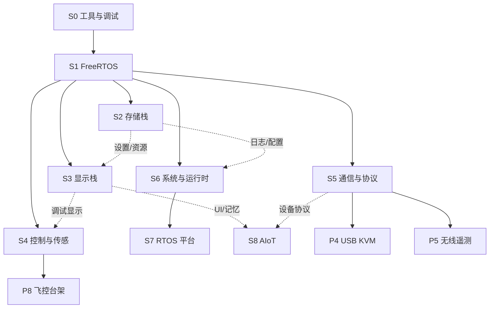
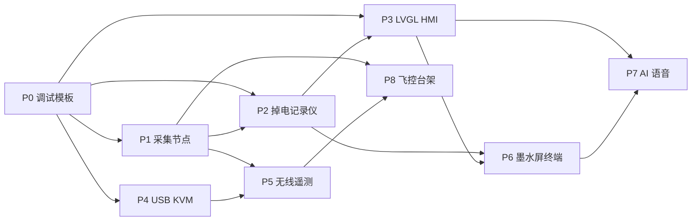

# references — 嵌入式源码学习与项目路线图

> 本目录下有 **25 个上游工程 + 1 份芯片引脚资料**，配套 **十余万行中文精读文档**，另有工作区级知识库 `../docs/knowledge-base/`。
>
> 这份文件只回答三个问题：
>
> 1. **学习顺序**：先读什么、后读什么、哪些可以跳过。
> 2. **复刻顺序**：先动手做哪个、买什么硬件、做到什么程度算过关。
> 3. **自研顺序**：从"跟着做"过渡到"自己做"，项目一个接一个怎么排。
>
> 一句话结论：
>
> **先把 `FreeRTOS + W25Q64 + OLED + F103` 这条最小闭环打通，再往显示、控制、USB、无线、系统架构扩展；不要从 Flipper、Mayhem、Zephyr 开始。**

---

## 目录

- [0. 先看结论](#0-先看结论)
- [1. 你的起点与使用原则](#1-你的起点与使用原则)
- [2. 学习顺序（S0–S8）](#2-学习顺序s0s8)
- [3. 复刻项目顺序（R0–R4）](#3-复刻项目顺序r0r4)
- [4. 自研项目顺序（P0–P8）](#4-自研项目顺序p0p8)
- [5. 硬件采购顺序与预算](#5-硬件采购顺序与预算)
- [6. 资料库地图（26 项）](#6-资料库地图26-项)
- [7. 每个工程怎么读](#7-每个工程怎么读)
- [8. 文档现状、已知错误与维护清单](#8-文档现状已知错误与维护清单)
- [9. 执行计划](#9-执行计划)
- [10. 附录](#10-附录)

---

## 0. 先看结论

### 0.1 三条路线一句话

| 路线 | 顺序 | 不适合现在做的 |
| --- | --- | --- |
| **学习** | FreeRTOS → 存储栈（SFUD/EasyFlash/FlashDB/littlefs）→ 显示栈（u8g2/TFT/LVGL）→ 控制（Power-Meter/Avem/IronOS）→ 通信（DeskHop/ExpressLRS）→ 系统架构（Flipper/MicroPython/Mayhem）→ RTOS 平台（Zephyr/NuttX/RIOT）→ AIoT（DesktopCompanion/loongson）；FreeRTOS 之后存储/显示/控制/通信可并行，不必串行 | 一上来读 Zephyr/NuttX/Mayhem |
| **复刻** | 零成本本机（FreeRTOS POSIX、littlefs 测试、FlashDB demo）→ 现有板+模块（F103 + OLED/W25Q64/INA226）→ 屏幕/双板（F411/F407 + TFT、2×Pico）→ 射频/飞行（SX1280、四轴） | 直接买 Flipper/HackRF/龙芯板 |
| **自研** | P0 多任务调试模板 → P1 采集节点 → P2 掉电记录仪 → P3 HMI 面板 → P6 低功耗墨水屏终端 → P7 AI 语音管家 → P4 USB KVM → P5 无线遥测 → P8 飞控台架（可选） | 第一个项目就做飞控或 AI 语音 |

### 0.2 最小闭环

如果你只有一个月，按这条线走：

```
F103C8T6 + SSD1306 OLED + W25Q64 + 杜邦线
        │
        ├─ FreeRTOS：3 任务 + 队列 + 信号量 + StreamBuffer
        ├─ u8g2：状态页/菜单
        ├─ SFUD：识别 W25Q64、读写擦
        ├─ EasyFlash NG：boot_count 掉电不丢
        └─ Shell：串口命令查看任务、栈水位、Flash 内容
```

跑通这条线，你就同时具备了：RTOS 任务设计、I2C/SPI 外设、外部 Flash、掉电安全、命令行调试。后面所有项目都是在这条线上加屏幕、加传感器、加协议。

### 0.3 三条路线怎么对齐

| 阶段 | 学习（读） | 复刻（跟做） | 自研（自己做） |
| --- | --- | --- | --- |
| S0 工具 | 调试方法/工具链 | R0 本机实验 | — |
| S1 RTOS | FreeRTOS + u8g2 | R1 FreeRTOS MVP + u8g2 | P0 调试模板 |
| S2 存储 | SFUD → EasyFlash → FlashDB → littlefs | R1/R2 W25Q64 系列 | P2 掉电记录仪 |
| S3 显示 | LVGL + OV-Watch/EPD 选读 | R2 LVGL + EPD | P3 HMI / P6 终端 |
| S4 控制 | Power-Meter → Avem | R1 Power-Meter / R3 Avem 台架 | P1 采集节点 / P8 可选 |
| S5 通信 | DeskHop → ExpressLRS | R2 DeskHop / R3 ExpressLRS | P4 USB KVM / P5 无线 |
| S6 系统 | Flipper → MicroPython | R4 只读/移植 | P7 AI 语音（部分） |
| S7 平台 | Zephyr/NuttX/RIOT 选一 | 上板跑 shell | — |
| S8 AIoT | DesktopCompanion + loongson | R4 PC 简化版 | P7 AI 语音 |

> 这张表只是把三条路线对齐，不是让你把同一个项目做三遍：S 是"读"，R 是"跟做一遍"，P 是"自己做并留下验收产物"，通常共用同一套硬件和代码。
>
> 复刻层级 R0–R4 按"成本/风险"划分，不严格等于时间顺序；实际周计划见第 9 节。学习、复刻、自研可以交错进行：例如 S1 读 FreeRTOS 时同步做 P0，S2 读 FlashDB 时同步做 P2。

---

## 1. 你的起点与使用原则

### 1.1 你已经有的（按工作区现状判断）

- 6 个参与 `build_all.sh` 的自建工程 + 1 个 F411 模板：STM32F103/F407/H743、ESP32-C3/S3、STC32G 的裸机 + FreeRTOS blink。
- 完整工具链：`arm-none-eabi-gcc 15.3.1`、`xtensa-esp-elf`、`riscv32-esp-elf`、SDCC MCS-251、OpenOCD、stcgal。
- 启动文件、链接脚本、Makefile、烧录脚本都做过；是否每块板都实际上板，以 `projects/README.md` 的记录为准。
- `references/` 下 25 个仓库都有中文导读/精读文档，`docs/knowledge-base/` 有约 295 篇逐文件笔记。
- 会 Python、能读 Makefile/CMake；串口和逻辑分析仪建议有，但不要假设已经熟练。

**还没具备、但后面会用到的工程前置**（缺什么补什么，不要一次全学）：

| 前置 | 用在哪 | 最低要求 |
| --- | --- | --- |
| Linux 或 Docker | Zephyr/NuttX/RIOT、Mayhem、MicroPython unix | 能跑 `docker run` 或一台 Ubuntu |
| CMake + Ninja | Zephyr、DeskHop、lvgl 示例 | 能读 `CMakeLists.txt`、能 `cmake -B build` |
| PlatformIO | ExpressLRS、esp32-weather-epd、Watchy | 能 `pio run -e <env>` |
| Python 3.10/3.12 | MicroPython、DesktopCompanion、Zephyr | 能建 venv、装依赖 |
| 焊接 | 传感器排针、电机线、电池 | 能焊排针/导线，不要求贴片 |
| µA 表 | P6 低功耗 | 能测 1µA–1mA 级电流 |
| Git/CI | 作品集、复盘 | 能建仓库、写 README、跑一次 CI |
| 英文数据手册 | 所有芯片/传感器 | 能查寄存器表和时序图 |

### 1.2 你还缺的（不是知识，是**闭环经验**）

| 缺口 | 表现 | 补齐方式 |
| --- | --- | --- |
| 多任务设计 | 会创建任务，但不会划分优先级、队列、栈预算 | FreeRTOS 深读 + P0 模板 |
| 外设组合 | 单个外设会用，多外设 + DMA + 中断一起就乱 | P1 采集节点 |
| 掉电安全 | 没做过"写一半断电"的验证 | P2 记录仪 + 1000 次断电 |
| 显示框架 | 只会画点/画线，没做过页面栈/刷新策略 | u8g2 → LVGL → P3 |
| 协议栈 | 没手写过 USB/HID、无线帧格式 | DeskHop/ExpressLRS + P4/P5 |
| 系统工程 | 代码一多就没有分层、没有日志、没有自检 | Flipper/MicroPython 的架构切片 |
| 低功耗 | 没量过 µA 级电流 | P6 墨水屏终端 |

### 1.3 使用原则

1. **不要以"读完 25 个仓库"为目标。** 以"做出 8 个项目"为目标，仓库是工具书。
2. **每个阶段只精读 1–2 个主仓库，其余按需查。** 例如做 P2 时只精读 FlashDB，littlefs 只读 `DESIGN.md` 和 `Docs/00`。
3. **先跑通，再深读。** 能编译、能上板、能看波形，比先读 3000 行源码有效。
4. **每个项目必须留下可验收的产物**：代码、测试记录、波形/截图、一篇复盘。
5. **读源码用"四遍法"**（见第 7 节），不要从第一行读到最后一行。

---

## 2. 学习顺序（S0–S8）

### 2.1 总览

| 阶段 | 时间（按每周 12–15h） | 主学 | 可并行 | 产出 | 验收 |
| --- | --- | --- | --- | --- | --- |
| **S0 工具与调试** | 3–5 天 | 工作区工具链、OpenOCD、逻辑分析仪、fault handler、DWT | — | 一份可复用的调试模板 | 能定位一次 HardFault、能测函数周期 |
| **S1 RTOS 内核** | 2–3 周（ThreadX 选学 +2–3 周） | `rtos/freertos` | `graphics/u8g2`、`rtos/ThreadX`（选学） | 3 任务 + 队列 + 信号量 + StreamBuffer | 栈水位、切换时间、72h 不死机 |
| **S2 存储栈** | 4–5 周 | `filesystems/SFUD` → `EasyFlash` → `FlashDB` → `littlefs` | — | W25Q64 上的 KV + 日志 + 文件系统 | 1000 次随机断电不丢数据 |
| **S3 显示栈** | 3–4 周 | `graphics/LVGL` | `firmware/OV-Watch`（GUI 架构）、`Watchy`/`esp32-weather-epd`（EPD/低功耗） | F411/F407 + TFT 三页 UI | ≥20fps 局刷、触摸、设置掉电保存 |
| **S4 控制与传感** | 3–4 周 | `firmware/Power-Meter` → `Avem` | `firmware/IronOS`（安全/电源）、`flix-hakimi-pio`（进阶） | 功率计 + 飞控台架 | 功率误差 <1%、PID 阶跃响应可解释 |
| **S5 通信与协议** | 4–6 周 | `firmware/DeskHop` → `ExpressLRS` | `OV-Watch`（UART 协议）、`Watchy`（BLE） | USB 键鼠切换 + 无线遥测 | 热键/边缘切换、100m 链路丢包 <1% |
| **S6 系统工程与运行时** | 4–6 周 | `firmware/flipperzero-firmware` → `micropython` | `mayhem-firmware`（DSP，选学） | 一个"服务化"的小系统 + 一个解释器移植 | 能画出 record/loader/VM 的数据流 |
| **S7 大型 RTOS 平台** | 4–8 周 | `rtos/Zephyr` → `NuttX` → `RIOT`（按目标选 1–2 个） | — | 一块板跑起 shell/文件系统 | 能改 DTS/Kconfig、能写 board |
| **S8 AIoT 支线** | 4–6 周 | `firmware/DesktopCompanion` → `loongson-medical-core` | — | ESP32 + PC LLM 语音终端 | 50 轮对话、记忆持久、设备可控 |

> S2–S5 不是严格串行：S1 之后可以按硬件/兴趣选一条主线（存储、显示、控制、通信），其他按需补。总时间不是各阶段简单相加，实际排期见第 9 节。

### 2.1.1 阅读池（按依赖分层，不是严格阶段顺序）

**核心 8 个（建议精读，其余按项目查）**：

1. `rtos/freertos` — RTOS 地基
2. `graphics/u8g2` — 调试显示屏
3. `filesystems/SFUD` — SPI NOR 驱动
4. `filesystems/EasyFlash` — KV/GC/掉电恢复（只看 NG）
5. `filesystems/FlashDB` — KVDB + TSDB
6. `filesystems/littlefs` — 文件系统
7. `graphics/LVGL` — GUI 框架
8. `firmware/Power-Meter` — 第一个完整小项目

**按方向选读（每个方向挑 1–2 个，不要全读）**：

| 方向 | 建议顺序 | 你学到什么 |
| --- | --- | --- |
| 控制/飞控 | `Avem` → `flix-hakimi` → `IronOS` | Mahony/PID/混控/温度环/安全保护 |
| 通信/协议 | `DeskHop` → `ExpressLRS` | USB/HID、无线空口、FHSS、硬实时 |
| 产品/低功耗 | `OV-Watch` → `Watchy` → `esp32-weather-epd` | 任务/页面栈、EPD、深睡、电池 |
| 系统架构/运行时 | `Flipper` → `MicroPython` → `Mayhem` | 服务化/record/loader、VM/GC、双核 DSP |
| RTOS 平台 | `ThreadX`（S1 后）→ `Zephyr` → `NuttX` → `RIOT` | 第二套内核、Kconfig/DT、POSIX/VFS、GNRC |
| AIoT | `DesktopCompanion` → `loongson` | LLM Agent、模型训练/量化/端侧部署 |

**查阅（不按顺序读）**：`datasheets/STC32G12K128-24A-LQFP64/`。

> 这不是“必读 25 个”。每个阶段只精读 1–2 个主仓库，其余按需查；能回答 7.4 的 5 个问题就可以停。S0–S8 的阶段顺序看 2.1 表，具体项目顺序看各阶段小节。

### 2.2 S0：工具与调试基本功（3–5 天）

**不要跳过。** 后面所有项目都会因为"不会定位 HardFault"而卡住。

要练的 8 件事：

1. `arm-none-eabi-gcc` 编译 + `objdump -d` 看反汇编，确认 `Reset_Handler` 和向量表。
2. OpenOCD + GDB：断点、单步、看寄存器、看内存、`monitor reset halt`。
3. HardFault 现场：从 `SCB->CFSR/HFSR/MMFAR/BFAR` 读出原因，打印出错 PC/LR。
4. DWT->CYCCNT 测函数周期；GPIO 翻转 + 示波器/逻辑分析仪测中断延迟。
5. 串口非阻塞收发：环形缓冲 + `HAL_UART_Receive_IT` 或 DMA + IDLE。
6. `nm`/`size`/`objdump -h` 看 Flash/RAM 预算；`__attribute__((section))` 放数据。
7. 逻辑分析仪抓 I2C/SPI：START/ADDR/ACK/DATA、CPOL/CPHA、CS 时序。
8. 看门狗 + 独立复位原因寄存器（RCC->CSR）。

**验收**：故意写一个空指针访问，能在 5 分钟内定位到文件和行号；能测出一次 EXTI 中断从触发到 GPIO 翻转的微秒数。

### 2.3 S1：RTOS 内核（2–3 周）

**主学：`rtos/freertos`**

为什么先学它：
- 你的 6 个 blink 工程已经带了 FreeRTOS，但只是"跑起来"，没有"用对"。
- 后面的 FlashDB/littlefs 锁、LVGL 任务、ESP-IDF、ExpressLRS 的 RTOS 抽象都建立在 FreeRTOS 概念上；存储/显示库本身可裸机跑，FreeRTOS 是集成推荐，不是编译前置。
- 它是就业市场的事实标准，资料也最全（Docs 4 篇 + KB 18 篇 + 286 个源文件中文化）。

阅读顺序：

```
Docs/00-内核总览与读码地图.md
  → list.c（双向链表，2 小时）
  → tasks.c 主线（创建/调度/延时/通知，1 天）
  → queue.c（队列/信号量/互斥量同源，1 天）
  → port.c（Cortex-M3/M4F 移植层，1 天）
  → timers.c / event_groups.c / stream_buffer.c（按需）
  → KB：tasks.md、queue.md、port_cortex_m4f.md
```

**必须搞懂的 8 个问题**：

1. TCB 里有什么？栈、优先级、状态、事件表项、通知值。
2. 任务切换的完整路径：SysTick/PendSV/SVC 各自做什么。
3. 为什么队列、信号量、互斥量是同一套代码？`itemSize=0` 意味着什么。
4. 优先级继承什么时候触发？为什么只在"取不到"时触发。
5. `FromISR` 版本与普通版本的区别？`pxHigherPriorityTaskWoken` 怎么用。
6. `configMAX_SYSCALL_INTERRUPT_PRIORITY` 与 BASEPRI 的关系。
7. heap_1/2/4/5 的区别；你的工程该用哪个。
8. 栈溢出怎么检测？高水位怎么读？

**并行：`graphics/u8g2`**
- 只读 `Docs/01-内存与缓冲模型`、`Docs/02-绘制管线`、`Docs/03-显示控制器与通信`。
- 在 F103 + SSD1306 上做一个状态页：任务列表、栈水位、队列深度、tick。
- 这是后面所有项目的"调试显示屏"，投入 1–2 天，回报极大。

**动手（MVP）**：3 任务 + 1 队列 + 1 信号量 + 1 StreamBuffer
- `vSensorTask` 100ms 采样 → 队列
- `vCtrlTask` 收队列 → 控制 LED
- `vLedTask` 500ms 翻转
- EXTI 按键 → `xSemaphoreGiveFromISR`
- UART DMA + IDLE → StreamBuffer → 命令解析任务
- 串口打印：每个任务的栈高水位、切换次数、队列深度

**验收**：
- 连续跑 72 小时不死机；
- 能口述一次 PendSV 切换的 8 个步骤；
- 能算出每个任务的栈预算，并解释余量；
- 能把 `configUSE_TICKLESS_IDLE` 打开并测待机电流变化（进阶）。

**选学：`rtos/ThreadX`（+2–3 周）**
- 放在 FreeRTOS 之后，不要放进 S2 存储阶段；它的 8 篇 Docs + 9 篇 KB 约 5,100 行，1–2 周只能浏览。
- 不要当"第二个 API"学，要当"第二套实现"对照学。
- 重点看三样 FreeRTOS 没有的东西：零动态内存、ISR 里可直接调 API、抢占阈值。
- 在 F103/F407 上跑官方 `sample_threadx`，改 `SYSTEM_CLOCK` 和向量表。
- 注意：ThreadX 的 `docs/04` 队列 flush 语义、`docs/05` 的 `#error` 归因有错误（见第 8 节），读的时候以源码为准。

### 2.4 S2：存储栈（4–5 周）

**推荐顺序：SFUD → EasyFlash NG → FlashDB → littlefs**

SFUD 是硬前置（所有上层都要块设备）；EasyFlash 和 FlashDB 是同一 KV 线（后者是前者的后继）；littlefs 只依赖块设备，可以独立学。项目优先可以把 EasyFlash 压缩成 3–5 天，直接 SFUD → FlashDB → littlefs。

| 顺序 | 仓库 | 你学到什么 | 时间 |
| --- | --- | --- | --- |
| 1 | `filesystems/SFUD` | SPI NOR 驱动、JEDEC ID、SFDP、页编程、擦除 | 2–3 天 |
| 2 | `filesystems/EasyFlash`（只看 NG 模式） | KV 状态机、追加写、GC、掉电恢复 | 3–5 天 |
| 3 | `filesystems/FlashDB` | FAL 分区、KVDB + TSDB、缓存、GC | 1–1.5 周 |
| 4 | `filesystems/littlefs` | 元数据对、CTZ、gstate/orphan、磨损均衡 | 1.5–2 周 |

**硬件**：F103C8T6 + W25Q64（8MB，4KB 扇区）+ ST-Link + 杜邦线，约 ¥40–80。

**阅读重点**：

- SFUD：`docs/01-SFDP探测机制`、`docs/03-读写擦除全流程`、`docs/05-实测与移植指南`。
- EasyFlash：`docs/02-环境变量读写全流程`、`docs/03-GC与磨损均衡`、`docs/04-掉电安全与恢复`。
  - 只读 NG 模式；`ef_env_legacy.c` 和 `ef_env_legacy_wl.c` 浏览即可。
- FlashDB：`docs/02-KVDB存储模型`、`docs/04-TSDB时序模型`、`docs/05-掉电安全设计`、`docs/06-FAL与移植层`。
  - 注意：`docs/02/03` 把 KV 头写成 18 字节，实际是 24 字节（见第 8 节）。
- littlefs：`Docs/02-元数据对与提交日志`、`Docs/03-掉电一致性与deorphan`、`Docs/04-磨损均衡与块分配`。
  - 先读 `DESIGN.md` 的设计权衡，再读 `lfs.c` 的 5 个核心区段。

**动手（MVP）**：掉电安全数据记录仪
- SFUD 识别 W25Q64，打印 JEDEC ID、容量、擦除粒度。
- 划 1MB 给 littlefs，512KB 给 KVDB，512KB 给 TSDB。
- KVDB 存 `boot_count`、`device_id`、`wifi_ssid`。
- TSDB 每秒追加一条 `{v, i, p, temp}`：前三个来自 P1 的 INA226，`temp` 来自 DS3231 内部温度（要湿度就加 BME280）。
- 每次上电 `boot_count++`，随机断电 1000 次，验证只允许"少加一次"，不允许回退/读不出。
- littlefs 写 `boot.txt`，断电后 `lfs_mount` 不失败，内容只能是旧值或新值。
- 测 GC 最坏延迟：把 KVDB 写满，记录一次 `set` 的最大耗时。

**验收**：
- 1000 次断电后 `boot_count` 单调、TSDB 可遍历、littlefs 可挂载；
- 能解释"为什么 SPI NOR 只能 1→0，所以状态机要单向推进"；
- 能画出 FlashDB → FAL → SFUD 的分层图；
- 能说出 littlefs 的 metadata pair 如何裁决掉电时的两个块。

### 2.5 S3：显示栈（3–4 周）

**顺序：TFT 裸机驱动 → u8g2 复习 → LVGL**

| 步骤 | 内容 | 时间 |
| --- | --- | --- |
| 1 | 自己写 ILI9341/ST7789 SPI 驱动：init 序列、窗口、GRAM 写、DMA、双缓冲 | 3–5 天 |
| 2 | u8g2 复习：页缓冲 vs 全缓冲、裁剪、字体 RLE | 1 天 |
| 3 | LVGL：对象树、样式、事件、脏区、flush_cb、indev | 2 周 |
| 4 | OV-Watch 的页面管理器、Watchy/weather-epd 的低功耗刷新 | 3–5 天（选读） |

**芯片边界（很重要）**：

| 芯片 | RAM/Flash | 能做什么 | 不能做什么 |
| --- | --- | --- | --- |
| F103C8 | 20KB/64KB | u8g2、裸机 TFT 简单绘图 | LVGL v10 官方下限 32KB RAM/128KB Flash，跑不动 |
| F411 | 128KB/512KB | LVGL 320×240 PARTIAL、RGB565、SPI DMA | 大屏双缓冲、LTDC |
| F407 | 192KB/1MB | LVGL 320×240、FSMC 8080、SPI DMA | 800×480 双缓冲 |
| H743 | 1MB/2MB + SDRAM | LVGL DIRECT、LTDC、DMA2D、800×480 | 需要处理 D-Cache |

> 上表只列 F103C8。F103RC/ZE（48–64KB RAM、256–512KB Flash）在 LVGL v10 最低线以上，可以跑最小配置，但 320×240 全屏缓冲仍然吃紧；不要把它当彩色 GUI 的主力板。

**阅读重点**：
- LVGL：`docs/00-总览与架构`、`docs/02-渲染管线与刷新`、`docs/03-draw层精读`、`docs/04-显示驱动接口`、`docs/05-输入设备与触控`。
- OV-Watch：`Docs/03-页面管理器与GUI架构`、`Docs/04-数据流与发布订阅`、`Docs/07-低功耗与运行模式`。
- Watchy：`Docs/05-Wi-Fi与低功耗实测指南`。
- esp32-weather-epd：`Docs/03-墨水屏驱动与刷新时序`、`Docs/05-低功耗与实测指南`。

**动手（MVP）**：F411/F407 + 2.8" ILI9341/ST7789 + LVGL
- 3 个页面：仪表盘、设置、关于；页面栈 + 返回键。
- 触摸/按键输入；一个 slider 控制 LED 亮度；一个 chart 显示采样。
- 设置项写入 FlashDB KVDB，掉电重启后恢复。
- 用 `lv_timer_handler()` 在独立任务里跑，栈 8–16KB；其他任务通过队列/observer 传数据。

**验收**：
- 局刷帧率 ≥ 20fps（320×240，SPI 40MHz）；
- 页面切换无撕裂、无内存泄漏（连续切 1000 次）；
- 能解释 PARTIAL/FULL/DIRECT 三种 buffer 模式和 flush_cb 的握手；
- 能说出为什么 F103C8（20KB RAM）不能跑 LVGL v10，以及 F103RC/ZE 为什么也只能跑最小配置。

### 2.6 S4：控制与传感（3–4 周）

**顺序：Power-Meter → Avem → IronOS（选读）→ flix-hakimi（进阶）**

| 项目 | 定位 | 难度 | 你学到什么 |
| --- | --- | --- | --- |
| `Power-Meter` | F103 + INA226 + CAN + VOFA | 2/5 | 完整小项目：传感器 → 总线 → 上位机 |
| `Avem` | F103RCT6 + MPU6050 + Mahony + 串级 PID | 3/5 | 姿态解算、PID、PWM 混控 |
| `IronOS` | 电烙铁固件 | 4.5/5 | 温度环、USB PD/QC、安全保护、设置持久化 |
| `flix-hakimi-pio` | ESP32 + VL53L1X 激光定高 | 5/5 | 完整飞控：1kHz 主循环、定高、MAVLink、WebUI |

**Power-Meter 阅读重点**：
- `Docs/02-INA226驱动精读`、`Docs/03-主循环与CAN任务`、`Docs/04-VOFA协议与串口DMA`、`Docs/06-复刻实战手册`。
- 注意坑：INA226 模块的分流电阻常见 R010/R100，与代码默认 1mΩ 不一致；功率寄存器是无符号，代码用 `int16_t`，功率满量程约 817.5W 会变负，而发送函数按 0.01W 单位打包时 327.67W 就先溢出；4 次阻塞 I2C 在 500Hz ISR 里，总线异常可能卡死。

**Avem 阅读重点**：
- `docs/04-姿态解算`、`docs/05-串级PID`、`docs/06-电机PWM混控`。
- 先读 `avm_mpu6050.c` 的 Mahony 部分，再读 `avm_pid.c`，最后看 `avm_motor.c` 的 TIM3 PWM。
- 注意：原版是 **STM32F103RCT6**（256KB Flash/48KB RAM），不是 Blue Pill C8T6；控制环由 USART1 收到 `$` 才执行（`avm_uart.c`），主循环空转，不是板上定时 500Hz。要用 C8T6 做台架，需改 linker/芯片宏，并把控制搬进定时中断，或让 PC 每 2ms 发 `$`。
- 注意：`docs/00` 的 I2C 引脚写错了（PB13/PB14-15），实际 `avm_i2c.h` 是 SCL=PB15、SDA=PB14；源码注释写 ±8g，实际 `ACCEL_CONFIG=0x01` 是 ±2g，且 `/1671.83` 输出的是 m/s² 不是 g；PWM 500Hz 的示例按公式是 5.0kHz（72MHz/(100×144)）。

**动手（MVP）**：
- Power-Meter：F103 + INA226 + USB-TTL + VOFA，先不接 CAN；用已知负载校准，误差 <1%；再加 SN65HVD230 + USB-CAN 分析仪，验证 0x605 大端帧。
- Avem：F103RCT6（或移植到 Blue Pill）+ MPU6050 + 4 个空心杯/MOSFET 桌面台架，**卸桨**，只跑 Mahony + Roll PID，用示波器看 CCR；原版需要 PC 每 2ms 发 `$` 触发控制，先把它改成定时中断再谈"闭环"；不要直接上桨。

**验收**：
- 能解释 P/I/D 对阶跃响应的影响，并用手上的曲线证明；
- 能说出四元数/欧拉角/万向节锁的关系；
- 能画出"采样 → 解算 → PID → 混控 → PWM"的完整数据流；
- 能解释为什么飞控控制环要放在定时中断，而不是主循环。

### 2.7 S5：通信与协议（4–6 周）

**顺序：DeskHop → ExpressLRS**

| 项目 | 训练的能力 | 难度 | 复刻成本 |
| --- | --- | --- | --- |
| `DeskHop` | USB Device + Host、HID 描述符、复合设备、PIO、双板 UART、OTA | 4/5 | ¥100–160 |
| `ExpressLRS` | 无线空口、CRC/FEC、FHSS、硬实时 Tock/相位、LQ/动态功率 | 5/5 | ¥200–400 |

**DeskHop 阅读重点**：
- `Docs/01-启动流程与双核调度`、`Docs/02-板间UART协议精读`、`Docs/03-USB HID 设备侧`、`Docs/04-USB主机侧与设备枚举`、`Docs/05-HID报告解析与转发`。
- 先读 `usb_descriptors.c` 和 `hid_parser.c`，再读 `mouse.c` 的虚拟光标和 `handlers.c` 的切换收口。
- 抓包工具：Wireshark + USBPcap（Windows）或 `usbmon`（Linux）；逻辑分析仪看 D+/D-。

**ExpressLRS 阅读重点**：
- `Docs/02-OTA 空中协议精读`、`Docs/03-链路质量与自适应速率`、`Docs/04-CRSF 协议对接`、`Docs/05-收发机硬件抽象与目标配置`。
- 先读 `OTA.h` 的位打包/CRC/FEC，再读 `FHSS.cpp` 和 `tx_main.cpp` 的 Tock。
- 注意：当前 targets 只有 ESP32/S3/C3/ESP8285，没有 STM32；README/导读说支持 STM32 已过时；快照还缺 `src/hardware/` 的 `targets.json`，直接编译会因 `hardwareUndefined` 失败，需要从上游 Configurator 取目标 JSON 或买成品 TX/RX；`Docs/01` 的 `rx_main` 行号、`Docs/02` 的 SYNC 包长度都有错误（见第 8 节）。

**动手（MVP）**：
- DeskHop：2×Pico + USB-A 转接 + UART 交叉（**必须加 ISO7721 或确认两板不共地形成环路**），先单 PC 键鼠透传，再加第二台 PC 和边缘切换；不一定要原 PCB。
- ExpressLRS：2×ESP32-S3/C3 + 2×SX1280 2.4G 模块 + 天线 + 衰减器，10mW/50Hz，先验证绑定/LQ/RSSI，再测 CRSF/PWM；**先接天线再发射**，不要碰 900M 和大功率。

**验收**：
- 能画出 USB 枚举的 8 个步骤（复位、地址、描述符、配置、接口、端点、HID report、SET_IDLE）；
- 能解释 HID report descriptor 的 usage page/usage/report size/report count；
- 能画出一次无线包从 TX 到 RX 的位流（前导码、同步字、长度、payload、CRC/FEC）；
- 能解释 FHSS 为什么需要相位同步，以及丢包时如何恢复。

### 2.8 S6：系统工程与运行时（4–6 周）

**顺序：Flipper → MicroPython → Mayhem（选学）**

| 项目 | 最值得学的东西 | 难度 | 能否动手 |
| --- | --- | --- | --- |
| `flipperzero-firmware` | Furi 服务化、record 服务定位器、event loop、FAP 插件加载器、GUI 单渲染线程 | 4.5/5 | 只能读；买真机才跑 FAP |
| `micropython` | 对象模型、qstr、GC、NLR、字节码 VM、STM32 port | 4/5 | 能动手：unix port、F411/F407/H743、ESP32 |
| `mayhem-firmware` | 双核共享内存、EventDispatcher、BasebandProcessor、DMA 乒乓、TX drain | 5/5 | 只能读；需要 HackRF + PortaPack |

**Flipper 阅读切片（20% 收益最大）**：
- `Docs/02-Furi 内核精读`、`Docs/03-服务与记录模型`、`Docs/04-应用框架与加载器`。
- 源码：`furi/core/thread.c`、`record.c`、`message_queue.c`、`event_loop.c`、`flipper.c`、`loader.c`、`gui/view_port.c`。
- 跳过：`lib/` 下的协议库、SubGHz/NFC/RFID 应用。

**MicroPython 阅读切片**：
- `mp-notes/02-对象模型精读`、`mp-notes/03-字节码虚拟机`、`mp-notes/04-垃圾回收`、`mp-notes/06-端口移植与C扩展`。
- 源码：`py/obj.[ch]`、`py/vm.c`、`py/gc.c`、`py/qstr.c`、`py/nlrthumb.c`、`py/runtime.c`、`ports/stm32/main.c`。
- 跳过：`lexer/parse` 细节、除 STM32 外的 port。
- 动手：先编译 unix port，再编译 `NUCLEO_F411RE` 或 `NUCLEO_H743ZI`，最后加一个 C 扩展模块。

**Mayhem 阅读切片**：
- `docs/03-接收链路与基带`、`docs/04-发射链路与应用`。
- 源码：`event_m0.cpp`、`baseband_thread.cpp`、`baseband_dma.cpp`、`receiver_model.cpp`、`radio.cpp`。
- 跳过：79 个 App、协议解码、ChibiOS 内部、`hackrf/host`。

**验收**：
- 能画出 Flipper 的"服务启动 → record → 应用订阅 → event loop → GUI"链路；
- 能解释 MicroPython 的 `mp_obj_t` 低位标记和 GC 的 ATB 链；
- 能说出 Mayhem 的 8KB 共享内存为什么用两个 2KB 队列 + 裸指针；
- 能把这些设计映射到自己的 STM32 项目（例如用 record 思想做服务注册）。

### 2.9 S7：大型 RTOS 平台（4–8 周，选学）

**不要全学。按目标选 1–2 个。**

| 项目 | 最适合谁 | 前置 | 本机可行性 |
| --- | --- | --- | --- |
| `rtos/Zephyr` | 想做 BLE/IoT 产品、跨厂商平台、求职 | CMake、Kconfig、DT、Python 3.12 | Zephyr 官方支持 macOS（brew 装 cmake/dtc，pip 装 west），但依赖多；Linux 更省事 |
| `rtos/NuttX` | 想做无人机/机器人、POSIX/文件系统/ELF | Linux/POSIX 编程、VFS、ELF | 建议 Linux/Docker；快照里 F1/F4 端口被裁剪，H743 端口完整；需要 apps/ |
| `rtos/RIOT` | 想用最小代码理解调度/消息/IPv6 | make、TCP/IP、6LoWPAN | macOS native 不支持，需 Linux/Docker |

**阅读顺序（每个）**：
```
Docs/00-总览与架构
  → 启动流程
  → 调度/线程
  → 同步/IPC
  → 设备模型/驱动框架
  → 构建系统与移植
```

**验收**：
- Zephyr：在 F103RB 或 H743 上跑 `hello_world` + `blinky`，改 `app.overlay` 换 LED 引脚，开 shell。
- NuttX：在 H743 上跑 `nucleo-h743zi:nsh`，执行 `ls /dev`、`ps`、`free`，注册一个字符驱动。
- RIOT：在 Linux/Docker 下跑 `native` hello-world，再在 F103RB 上跑 shell + `msg_send_receive`。

### 2.10 S8：AIoT 支线（4–6 周，选学）

| 项目 | 定位 | 真实价值 | 注意 |
| --- | --- | --- | --- |
| `DesktopCompanion` | PC 端 LLM Agent + ESP32 骨架 | host 侧架构完整，设备端只有 hello world | 需要 Python 3.10+、OpenAI 兼容端点；无 LICENSE |
| `loongson-medical-core` | 龙芯离线语音病历 | 模型训练/量化/语音链路完整 | 需要 LoongArch 硬件；权重/LoRA 缺失；量化脚本与 gguf 0.19 不兼容；无 LICENSE |

**建议**：不要照抄。用 DesktopCompanion 的 host 骨架（event/pipeline/skill/memory），自己写 ESP32 设备端协议；loongson 只读它的 `fix_wav_file`、`clean_text`、ChatML 组织、`extract_record` 思路，不要用它的 Python 量化脚本。

**验收**：ESP32-S3 + PC 本地 Ollama/DeepSeek，push-to-talk → STT → LLM → 设备控制 → TTS，50 轮不崩，记忆持久。

### 2.11 依赖关系图



实线 = 硬前置；虚线 = 推荐/软依赖。

**关键依赖解释**：
- **S1 是共同前置**：FreeRTOS 不是存储/显示库的编译前置（它们都能裸机跑），但它是多任务集成、LVGL 任务、ESP-IDF/ExpressLRS 的推荐前置。
- **S2 与 S3 可并行**：Flash 是 LVGL 设置持久化/图片资源的软前置，不是硬依赖；没有 S2 也能先用 RAM 跑 LVGL。
- **S3/S4/S5 是 S1 后的三条并行分支**：做控制不需要先做 GUI；做 USB/无线也不需要先做 PID。按兴趣/硬件选一条主线，其他按需补，不必串行多花 3–4 周。
- **S6/S7 放后面**：系统架构和大型 RTOS 平台需要你先有独立项目经验，否则容易"看懂但用不上"。

---

## 3. 复刻项目顺序（R0–R4）

> "复刻"不等于"买一模一样硬件"。能用现有板 + 模块验证核心机制，就算复刻成功。

### 3.1 总览

| 层级 | 项目 | 硬件 | 成本 | 时间 | 风险 | 验收 |
| --- | --- | --- | --- | --- | --- | --- |
| **R0 零成本** | FreeRTOS POSIX port | PC | ¥0 | 1 天 | 无 | 生产/消费 2 任务跑通 |
| R0 | littlefs host tests | PC | ¥0 | 1–2 天 | 无 | 约 2k 排列通过（`make test`） |
| R0 | FlashDB Linux demo | PC | ¥0 | 半天 | 无 | KV/TSDB 示例跑通 |
| R0 | MicroPython unix port | PC | ¥0 | 1–2 天 | 低 | REPL 跑起来 |
| **R1 低成本** | FreeRTOS MVP | F103 + LED | ¥0–30 | 2–3 天 | 低 | 72h 不死机 |
| R1 | u8g2 状态页 | F103 + SSD1306 | ¥20–40 | 1–2 天 | 低 | 菜单/波形/任务表 |
| R1 | SFUD + W25Q64 | F103 + W25Q64 | ¥25–45 | 2–3 天 | 低 | 读写擦 + 跨页 |
| R1 | EasyFlash NG | F103 + W25Q64 | ¥25–45 | 3–5 天 | 低 | 100–1000 次断电 |
| R1 | Power-Meter | F103 + INA226 + CAN | ¥40–135 | 1–2 周末 | 低–中 | 误差 <1%、CAN 帧 |
| R1 | FlashDB KV/TSDB | F103 + W25Q64 | ¥25–45 | 1 周 | 中 | GC/掉电/时间查询 |
| **R2 中成本** | littlefs | F103 + W25Q64 | ¥25–45 | 1–2 周 | 中 | 掉电挂载 |
| R2 | LVGL HMI | F411/F407 + 2.8" TFT | ¥100–200 | 2–4 周 | 中 | 3 页 UI、≥20fps |
| R2 | esp32-weather-epd | FireBeetle 2 ESP32-E + 7.5" EPD + BME280 | ¥350–520 | 1–2 周 | 低 | 30min 刷新、深睡 |
| R2 | Watchy 风格手表 | ESP32 + 1.54" EPD | ¥150–250 | 1–2 周 | 中 | 时钟/菜单/深睡 |
| R2 | OV-Watch 部分功能 | F411 + ST7789 + 传感器 | ¥150–250（部分）/ ¥400–600（原板套件） | 3–4 周 | 中高 | 表盘/页面/低功耗 |
| R2 | DeskHop | 2×Pico + ISO7721 | ¥130–190 | 1–2 周末 | 中 | 双 PC 切换 |
| **R3 高成本/高风险** | Avem 台架 | F103RCT6（或移植 C8T6）+ MPU6050 + 电机 | ¥150–300 | 2–4 周末 | 高 | 卸桨 PID |
| R3 | flix-hakimi | ESP32 + VL53L1X + 电机（需补依赖） | ¥250–450 | 3–6 周末 | 很高 | 系留低油门 |
| R3 | ExpressLRS | 2×ESP32 + 2×SX1280（需目标 JSON） | ¥200–400 | 2–4 周末 | 高 | 100m 链路 |
| **R4 只读/成品** | IronOS | 买 Pinecil/TS101 | ¥400–550 | 1 天刷机 | 中 | 刷入并能调温 |
| R4 | Flipper | 买真机 | ¥1800–2500 | — | — | 只读/装 FAP |
| R4 | Mayhem | HackRF + PortaPack | ¥1200–2000 | — | — | 只读 |
| R4 | loongson | 龙芯板 | 高 | — | — | 只读/PC 简化版 |

> 价格为 2026 年参考价，以实时价为准。R0–R4 按"成本/风险"分层，不严格等于时间顺序；实际执行以第 9 节的分阶段计划为准。Power-Meter 在 R1 里，但计划把它放在存储之后，作为"第一个完整小项目"。

### 3.2 R0：零成本本机复刻（1 周）

**目标**：在没有硬件的情况下，把"编译 → 运行 → 改参数 → 看结果"跑通。

1. **FreeRTOS POSIX port**
   - 用 `portable/ThirdParty/GCC/Posix/port.c` + 自写 `FreeRTOSConfig.h`，clang 编译。
   - 生产/消费两任务 + 队列，输出 `produced=10 consumed=10`。
   - 注意：不要直接用 `examples/template_configuration/FreeRTOSConfig.h` 配 POSIX port，heap 太小会挂死。

2. **littlefs host tests**
   - `make test-runner` 只编译测试运行器；用 `make test` 跑全套。
   - 需要 Python `toml`；测试套件有约 2k 个排列（不是 771 个），跑完约几分钟；官方假设 Linux，macOS 报错就用 Docker。
   - 先跑 `test_dirs`、`test_powerloss`、`test_badblocks` 三个关键套件。

3. **FlashDB Linux demo**
   - `cd demos/linux && make && ./FlashDBLinuxDemo`。
   - 注意：demo 在同一秒内追加两条 TSDB 记录会触发"时间戳不递增"警告，不是库缺陷。

4. **MicroPython unix port**
   - 在仓库根 `make submodules`，然后 `make -C mpy-cross`，最后 `cd ports/unix && make`；否则会缺 libffi/子模块。
   - macOS 需要 `brew install libffi pkg-config`；如果完整版报错，先 `make VARIANT=minimal`。
   - 跑 REPL 和 `tests/`；仍然失败就优先用 Linux/Docker。

**验收**：每个项目都能编译、运行、改一个参数并观察行为变化。

### 3.3 R1：低成本、现有板 + 模块（4–8 周，分散在 S1–S2）

**目标**：用一块 F103 和不超过 ¥150 的模块，把"RTOS + 显示 + 存储 + 传感"串起来。

顺序：

```
FreeRTOS MVP → u8g2 → SFUD → EasyFlash NG → Power-Meter → FlashDB
```

**关键原则**：
- 每个项目只加一个新模块，不要一次买齐。
- 每加一个模块，先写"最小验证程序"（打印 ID/读写一个字节/点亮一个像素），再集成。
- 每个项目都要有"掉电测试"或"异常测试"，不要只跑正常路径。

**验收**：
- 一块 F103 上同时跑 FreeRTOS + OLED 状态页 + W25Q64 KV + INA226 采样；
- 串口 shell 能查看任务、栈水位、KV 内容、Flash 用量；
- 随机断电 1000 次，`boot_count` 不回退。

### 3.4 R2：屏幕、双板与低功耗（8–14 周）

**目标**：从"单板模块"升级到"完整设备"。

顺序建议：

```
littlefs → LVGL HMI → OV-Watch 部分 → esp32-weather-epd → Watchy 风格 → DeskHop
```

- **littlefs**：在 R1 的 W25Q64 上划 1MB，做文件读写 + 掉电挂载。
- **LVGL**：F411/F407 + 2.8" TFT，做 3 页 UI + 触摸 + 设置持久化。
- **esp32-weather-epd**：最容易的"完整产品"复刻，BOM 三个模块，几乎免焊；但低功耗依赖 FireBeetle 2 ESP32-E（普通 DevKit 深睡达不到 <50µA），不要拿普通板子验收功耗。
- **Watchy 风格**：把 EPD 手表做成桌面时钟，先不做腕表外壳。
- **OV-Watch 部分**：用 F411 黑药丸 + ST7789 + MPU6050/AHT21，做表盘 + 3 个页面 + STOP 低功耗；不做完整腕表。
- **DeskHop**：2×Pico + 隔离器，先单 PC 透传，再双 PC 切换。

**验收**：
- LVGL 连续切页 1000 次无泄漏；
- EPD 终端深睡 <50µA（FireBeetle）、5000mAh + 30min 刷新 ≥1 个月；
- DeskHop 双 PC 切换延迟 <100ms、键盘 LED 跟随。

### 3.5 R3：射频、飞行与高风险（8–16 周，可选）

**只在你已经完成 R2、并且有安全场地/设备时做。**

- **Avem 台架**：原版是 F103RCT6 + MPU6050 + 4 个空心杯/MOSFET，**卸桨**，只验证 Mahony + PID + PWM；控制由 PC 每 2ms 发 `$` 触发，不是板上定时中断。用 Blue Pill 需先改 linker/芯片宏并把控制搬进定时器。
- **flix-hakimi**：ESP32 + VL53L1X + 8520 空心杯，先系留、低油门、护罩；但仓库缺 `build.sh`、`platformio.ini`、`tools/` 和 `FlixPeriph.h`/`SBUS.h`/`MAVLink.h`，**不是开箱可编译**，要按上游补齐依赖后再算复刻。
- **ExpressLRS**：2×ESP32 + 2×SX1280 2.4G，10mW/50Hz，先衰减器 + 1–2m，再逐步拉距离；快照缺 `src/hardware/targets.json`，要先从上游 Configurator 生成目标 JSON，否则编译会停在 `hardwareUndefined`；不要碰 900M 和大功率。
- **IronOS**：不建议 DIY 加热功率级（市电/高压/大电流）；买 Pinecil/TS101 刷机，或只读代码。

**验收**：
- 飞控：能解释一次阶跃响应，能在台架上稳定保持姿态 10 秒；
- ExpressLRS：100m 视距丢包 <1%，失控保护 <1s；
- 所有高风险项目：有物理急停/断电开关，绝不带桨调试。

### 3.6 R4：只读/成品（不建议作为学习主线）

| 项目 | 为什么只读 | 替代方案 |
| --- | --- | --- |
| Flipper | 硬件 ¥1800–2500，无模拟器，FAP 需要真机 | 读 `Docs/02/03/04`，把 record/loader 思想用到 STM32 |
| Mayhem | 需要 HackRF + PortaPack，射频/CPLD 无法自制 | 读 `docs/03/04`，把双核/DSP 思想用到 ESP32-S3 |
| loongson | 需要 LoongArch 硬件，权重/数据缺失 | 在 PC 上做简化版语音链路 |
| IronOS | 功率级有安全风险 | 买成品刷机，或只读控制/保护代码 |

---

## 4. 自研项目顺序（P0–P8）

> 这一节是"你自己做什么"，不是"复刻哪个仓库"。每个项目都尽量复用上一项的硬件和代码。
>
> P0–P8 与 S/R 会有重叠：S 是"读"，R 是"照着跑一遍"，P 是"自己做并留下可验收产物"。例如 R1 的 Power-Meter 只是跑通示例，P1 要加校准、CAN、24h 连续采集和复盘；不要把同一个项目重复计算。

### 4.1 总览

| 顺序 | 项目 | 核心新技能 | 复用 | 硬件增量 | 时间 | 难度 |
| --- | --- | --- | --- | --- | --- | --- |
| **P0** | 多任务调试模板 | RTOS 任务/队列/StreamBuffer/shell/栈水位 | 现有 F103 | OLED + W25Q64 | 1–2 周 | 2/5 |
| **P1** | 功率/数据采集节点 | INA226、CAN、VOFA、DMA、校准 | P0 | INA226 + CAN 收发器 | 2 周 | 2/5 |
| **P2** | 掉电安全数据记录仪 | FlashDB KV/TSDB、littlefs、RTC、断电测试 | P0/P1 | DS3231 + W25Q64 | 3 周 | 3/5 |
| **P3** | LVGL HMI 参数面板 | TFT 驱动、LVGL、触摸、页面栈、设置持久化 | P0/P2 | F411/F407 + TFT | 3–4 周 | 4/5 |
| **P6** | 低功耗墨水屏环境终端 | EPD、深睡、RTC 唤醒、电池管理、BLE/WiFi | P2/P3 | FireBeetle 2 + EPD + BME280 + RTC | 3 周 | 3/5 |
| **P7** | 桌面 AI 语音管家 | ESP32 音频、串口 JSON、PC LLM Agent、记忆 | P3/P6 | ESP32-S3 + 麦克风/喇叭 | 3–4 周 | 4/5 |
| **P4** | USB KVM-lite | USB Host/Device、HID、双板协议、OTA | P0 | 2×Pico + 隔离器 | 4 周 | 4/5 |
| **P5** | 无线遥测节点 | 空口帧、CRC/FEC、跳频、LQ、失控保护 | P1/P4 | 2×ESP32 + SX1280 | 4 周 | 5/5 |
| **P8** | 飞控/云台台架（可选） | 姿态融合、串级 PID、混控、安全 | P1/P5 | 四轴硬件 | 4–6 周 | 5/5 |

**推荐主线：P0 → P1 → P2 → P3 → P6 → P7 → P4 → P5；P8 可选。**
理由：前 6 项共用 F103/F411 + 少量模块，每一步只加一个新维度；P4/P5 是协议深水区，放在后面；P8 风险最高，不作为主线。

### 4.2 P0：多任务调试模板（1–2 周）

**目标**：做一个你以后每个项目都能复用的"底板"。

功能：
- 3 个任务：传感器、控制、显示；1 个队列、1 个信号量、1 个 StreamBuffer。
- 串口 shell：`help`、`ps`（任务列表/栈水位）、`free`、`reboot`；`kv get/set`、`flash info` 等 S2 学完再加。
- OLED 状态页：CPU 占用、任务状态、队列深度、Flash 用量、错误计数。
- HardFault handler：打印 CFSR/HFSR/MMFAR/BFAR、出错 PC/LR、任务名。
- DWT 周期计数：测关键函数耗时。
- 看门狗 + 复位原因。

**验收**：
- 连续跑 72 小时，shell 可查、OLED 可看、看门狗不误复位；
- 故意制造一次栈溢出/空指针，能在 5 分钟内定位；
- 代码分层：`bsp/`、`app/`、`middleware/`、`main.c` 不含业务逻辑。

### 4.3 P1：功率/数据采集节点（2 周）

**目标**：把"传感器 → 总线 → 上位机"跑通。

功能：
- INA226 读电压/电流/功率，TIM 500Hz 采样。
- CAN 发 0x605 帧（4×int16 大端），或 UART + VOFA justfloat。
- 已知负载校准：用万用表/电子负载对比，误差 <1%。
- 串口命令：`cal`、`rate`、`stream on/off`。

**验收**：
- 0–2A 范围内误差 <1%；
- CAN 帧能被 USB-CAN 分析仪解析；
- 24 小时连续采集无丢帧；
- 能解释 INA226 的 Current_LSB/Calibration 寄存器。

### 4.4 P2：掉电安全数据记录仪（3 周）

**目标**：把 S2 的存储栈变成一个"敢断电"的产品。

功能：
- KVDB：`boot_count`、`device_id`、`wifi_ssid`、校准参数。
- TSDB：每秒一条 `{v, i, p, temp}`，带 RTC 时间戳；按时间区间查询。
- littlefs：配置文件 `cfg.json`、崩溃转储 `crash.bin`。
- 分区：1MB littlefs + 512KB KVDB + 512KB TSDB。
- 掉电测试：随机断电 1000 次，记录每次 `boot_count` 和最后一条 TSL。

**验收**：
- `boot_count` 单调，最多"少加一次"，不回退；
- 每次上电 `lfs_mount` 成功，`cfg.json` 只能是旧值或新值；
- TSDB 损坏记录最多丢最后一条；
- 能画出"状态机 + 双阶段提交 + GC"的掉电窗口图。

### 4.5 P3：LVGL HMI 参数面板（3–4 周）

**目标**：做一个"有页面、有触摸、有设置"的 HMI。

功能：
- 4 页：仪表盘、趋势图、设置、关于。
- 页面栈 + 返回键；页面生命周期 `init/deinit`。
- 触摸/按键输入；slider 调亮度、chart 显示采样。
- 设置写入 FlashDB KVDB，掉电恢复。
- 局刷 + 周期全刷；帧率显示。

**验收**：
- 320×240、SPI 40MHz，局刷 ≥20fps；
- 连续切页 1000 次无内存泄漏；
- 设置掉电后恢复；
- 能解释 LVGL 的 object tree/style/event/dirty area/flush 五件套。

### 4.6 P6：低功耗墨水屏环境终端（3 周）

**目标**：做一个"电池能撑一个月"的设备。

功能：
- **FireBeetle 2 ESP32-E**（低功耗关键，普通 DevKit 达不到）+ 7.5" EPD + BME280 + DS3231（或 PCF8563）+ 5000mAh 锂电。
- 每 30 分钟唤醒：读传感器 → 刷新 EPD → 深睡；想更快刷新可以改 5 分钟，但续航按比例缩短。
- 3 个页面：当前环境、24h 趋势、设置/二维码配网。
- 电池 ADC + 低电分级（正常/警告/关机）。
- BLE 或 WiFi 配置；OTA 可选。

**验收**：
- 深睡 <50µA（万用表 µA 档实测；**仅 FireBeetle 2 + 割 Low Power 焊盘**，普通 DevKit 放宽到 <150µA）；
- 5000mAh + 30 分钟刷新 ≥1 个月；改 5 分钟刷新则 ≥1 周（按每轮约 0.9mAh 估算）；
- 单次刷新 <2s；
- 断电重启后页面/设置不丢；
- 锂电必须带保护板、专用充电器、保险丝，充电时有人看管。

### 4.7 P7：桌面 AI 语音管家（3–4 周）

**目标**：做一个"能听、能说、能控制设备、有记忆"的 AIoT 终端。

功能：
- ESP32-S3：I2S 麦克风、功放/喇叭、OLED、按键、LED/继电器。
- PC host：Python asyncio + OpenAI 兼容端点（Ollama/DeepSeek）。
- 链路：按键录音 → WAV → STT → LLM → 工具调用 → TTS → 设备播放。
- 技能：`get_time`、`save_memory`、`search_memory`、`set_led`、`display_text`、`play_tts`。
- 记忆：STM 滑动窗口 + LTM 长期笔记；重启后保留。
- 协议：UART/WiFi 文本 JSON 行，`id` 请求/应答，事件帧。

**验收**：
- 一次语音问答 <5 秒（本地 0.5B、短句、STT/TTS 已缓存；云端/大模型另算）；
- 50 轮对话不崩，记忆不丢；
- 麦克风有物理/软件指示灯，API key 放 `.env` 不进 git；
- 设备命令成功率 >95%，超时/错误能回喂；
- 不保留 `run_shell` 等高危技能，设备控制有白名单/超时。

### 4.8 P4：USB KVM-lite（4 周）

**目标**：把 DeskHop 的核心机制用自己的代码实现一遍。

功能：
- 2×Pico：A 板 USB Device（复合 HID + 绝对鼠标），B 板 PIO-USB Host。
- 板间 UART 帧：类型/长度/序号/CRC/数据；两板之间**必须加 ISO7721 隔离**，不要直接共地。
- HID 描述符解析：从键盘/鼠标 report descriptor 提取 report size/count/usage。
- 虚拟光标：相对位移 → 绝对坐标；边缘切换。
- 热键切换；键盘 LED 跟随。
- OTA/自恢复可选。

**验收**：
- 单 PC 键鼠透传正常；
- 双 PC 边缘切换延迟 <100ms；
- 键盘 LED 跟随当前输出；
- 连续跑 8 小时不掉线；
- 能解释 USB 枚举和 HID report 的位布局。

### 4.9 P5：无线遥测节点（4 周）

**目标**：做一对"能测链路质量"的无线节点。

功能：
- 2×ESP32-S3/C3 + 2×SX1280 2.4G（或先用 ESP-NOW 做协议验证）。
- 帧格式：前导码/同步字/长度/序号/payload/CRC。
- 跳频：先做固定信道；FHSS + 相位同步作为 stretch goal（需要射频仪器/更长时间，不作为 MVP 验收）。
- 遥测：RSSI/SNR/LQ/丢包率/电压。
- 失控保护：丢包 1s → 缓降/停输出；动杆夺回。
- 地面站：串口/OLED 显示链路质量。

**验收**：
- 100m 视距、10,000 包 ×3 次，平均丢包 <1%（10mW、天线正确、先接天线再发射）；
- 失控保护 <1s；
- 能解释一次丢包后的重同步过程；
- 遵守当地无线电法规，不用 900M/大功率。

### 4.10 P8：飞控/云台台架（可选，4–6 周）

**目标**：理解姿态控制，但**不追求真飞**。

**硬件**：F103RCT6 或 F411 + MPU6050/MPU6500 + 4×空心杯 + 4×MOSFET/电调 + 65mm 机架 + 1S 电池 + 保护板 + 充电器 + 保险丝 + 灭火袋/烟雾报警；不要买大四轴，不要在室内带桨起飞。

功能：
- F103RCT6/F411 + MPU6050/MPU6500。
- Mahony/Madgwick 姿态融合。
- 串级 PID：角度外环 P + 角速度内环 PID。
- 混控：四轴 X 型；输出限幅/死区/怠速。
- 安全：解锁开关、油门归零、失控保护、超时断输出。
- 台架：单轴/双轴云台，或四轴卸桨。

**验收**：
- 能解释四元数到欧拉角的转换；
- 能用手上的阶跃响应整定 P/I/D；
- 台架上稳定保持姿态 10 秒；
- 所有测试卸桨/系留，有物理急停。

### 4.11 项目复用关系



### 4.12 安全红线（每次动手前看一遍）

| 场景 | 必须做 | 禁止 |
| --- | --- | --- |
| 锂电 | 保护板 + 专用充电器 + 保险丝 + 防火袋；充电有人看管 | 反接、过充、短路、无人充电 |
| 飞控/电机 | 卸桨/系留、护罩、物理急停、单人操作 | 室内带桨、疲劳调试、超近距离 |
| 射频 | 10mW、先接天线再发射、衰减器、遵守 SRRC | 900M/大功率、无天线发射、干扰他人 |
| USB KVM | ISO7721 隔离、两板不共地 | 直接 UART 共地跨两台电脑 |
| AI 语音 | 麦克风指示灯、API key 进 `.env`、最小权限 | 把 `run_shell` 留给模型、把 key 提交到 git |
| IronOS/加热 | 买成品刷机 | 自制市电/高压功率级 |

### 4.13 验收怎么测（别只看"能跑"）

| 指标 | 测量方法 | 样本/判定 |
| --- | --- | --- |
| RTOS 稳定性 | 串口打点 + 看门狗 + 栈高水位 | 72h，0 次 HardFault |
| 掉电安全 | USB 继电器/可编程开关随机断电，串口记录 `boot_count` | 100 次冒烟 + 1000 次正式，允许"少加一次" |
| LVGL 帧率 | `flush_cb` 翻转 GPIO + 逻辑分析仪，或用 LVGL perf | 320×240、SPI 40MHz，p95 ≥20fps |
| 功率精度 | 电子负载/万用表对比，0–2A 多点 | 误差 <1% |
| 深睡电流 | µA 表串在电池正极，等 30s 稳定后读均值 | FireBeetle <50µA；DevKit <150µA |
| 无线丢包 | TX 发 10,000 包，RX 计数，重复 3 次 | 平均 <1%，失控保护 <1s |
| USB 切换 | 秒表/逻辑分析仪测热键到 LED 切换 | <100ms，8h 不掉线 |

---

## 5. 硬件采购顺序与预算

> 价格是 2026 年国内电商参考价，按"能买到、能用"选，不追求原厂。

### 5.1 第 0 批：现在就能买（约 ¥100–150）

| 物品 | 建议型号 | 参考价 | 用途 |
| --- | --- | --- | --- |
| ST-Link V2 | 任意兼容 | ¥15–25 | 烧录/调试 |
| USB-TTL | CH340/CP2102 | ¥8–15 | 串口/shell |
| 0.96" OLED | SSD1306 I2C 128×64 | ¥8–15 | u8g2 状态页 |
| SPI NOR 模块 | W25Q64（8MB） | ¥4–8 | SFUD/FlashDB/littlefs |
| INA226 模块 | 注意分流电阻 R010/R100 | ¥5–8 | Power-Meter |
| 面包板 + 杜邦线 | 830 孔 + 公母 | ¥15–25 | 全部项目 |
| CAN 收发器 | SN65HVD230 | ¥3–6 | Power-Meter 进阶 |
| 120Ω 电阻 ×2 | 1/4W | ¥1 | CAN 终端 |

### 5.2 第 1 批：S2–S3（约 ¥150–250）

| 物品 | 建议型号 | 参考价 | 用途 |
| --- | --- | --- | --- |
| RTC 模块 | DS3231（带电池） | ¥8–15 | 记录仪时间戳 |
| 2.8" TFT | ILI9341/ST7789 SPI 320×240 + 触摸 | ¥35–60 | LVGL |
| F411 开发板 | 黑药丸 STM32F411CEU6 | ¥30–50 | LVGL/OV-Watch 部分 |
| 逻辑分析仪 | 8CH 24MHz（克隆） | ¥50–100 | I2C/SPI/USB 调试 |
| 传感器 | MPU6050、AHT21、BME280 | ¥5–20 各 | 控制/环境 |
| USB 继电器/可编程开关 | 任意 | ¥30–80 | 1000 次随机断电测试 |

### 5.3 第 2 批：S4–S5 + EPD（约 ¥600–1100）

| 物品 | 建议型号 | 参考价 | 用途 |
| --- | --- | --- | --- |
| Raspberry Pi Pico ×2 | RP2040 | ¥30–60 | DeskHop |
| 数字隔离器 | ISO7721DR / ADuM1201 | ¥10–20 | DeskHop 板间隔离 |
| ESP32-S3/C3 ×2 | DevKitC | ¥25–50 各 | ExpressLRS/AIoT |
| SX1280 2.4G 模块 ×2 | E28-2G4M12S/20S | ¥40–90 各 | ExpressLRS |
| 2.4G 天线 ×2 | 匹配模块 | ¥10–30 | 射频 |
| 衰减器 | 20–30dB | ¥30–60 | 近距离测试 |
| USB-CAN 分析仪 | 兼容 | ¥40–80 | CAN 调试 |
| FireBeetle 2 ESP32-E | DFRobot | ¥60–100 | EPD 低功耗 |
| 7.5" 墨水屏 | GDEY075T7 800×480 | ¥180–260 | EPD 气象站 |
| EPD 驱动板 | DESPI-C02 | ¥30–60 | EPD |
| 5000mAh 锂电 + 充电 | JST-PH + 保护板 | ¥40–70 | 低功耗终端 |

> 按 24 周地基版：FireBeetle、7.5" EPD、DESPI-C02、5000mAh 要在 W18 前买；Pico/SX1280/衰减器可以等完整版再买。

### 5.4 第 3 批：S6–S8（约 ¥200–350）

| 物品 | 建议型号 | 参考价 | 用途 |
| --- | --- | --- | --- |
| 1.54" 200×200 EPD | GDEH0154D67 | ¥60–120 | Watchy 风格 |
| ESP32-S3 DevKit | 官方/兼容 | ¥50–80 | AI 语音 |
| I2S 麦克风 | INMP441 | ¥10–20 | AI 语音 |
| 功放 + 喇叭 | MAX98357A + 3W | ¥20–30 | AI 语音 |
| 电池 + 充电 | 2000mAh + TP4056 | ¥20–40 | 低功耗终端 |

### 5.5 动力批：P8 飞控台架（约 ¥300–600，最后买）

| 物品 | 建议型号 | 参考价 | 用途 |
| --- | --- | --- | --- |
| 8520 空心杯 ×4 | 1S | ¥20–30 | 台架动力 |
| MOSFET/电调 ×4 | UMW 100N03A 或小电调 | ¥20–60 | 电机驱动 |
| 65mm 机架 | 3D 打印/碳纤 | ¥30–80 | 台架 |
| 桨 ×多 | 65mm | ¥10–20 | 只在地面测试 |
| 1S 电池 + 充电器 | 带保护板 | ¥40–80 | 动力 |
| 保险丝/烟雾报警/灭火袋 | — | ¥30–50 | 安全 |
| 电机测试架/护罩 | — | ¥30–80 | 安全 |

### 5.6 预算建议

- **最小闭环（R0+R1）**：¥100–150。
- **地基版（R0–R2 + P0–P3 + P6）**：¥600–1000。
- **完整版（加 S4/S5/P4/P5/P7）**：¥1500–2600。
- **动力批（P8）**：再 ¥300–600，风险最高，最后买。
- 以上为 2026 年参考价，以实时价为准；不要为了"凑齐"一次买完。

### 5.7 不建议买

- Flipper Zero（¥1800–2500）：学习价值高，但硬件贵、无模拟器，先读代码。
- HackRF + PortaPack（¥1200–2000）：射频/CPLD 无法自制，先读 Mayhem。
- 龙芯/LoongArch 板：除非明确要做边缘 AI 部署。
- 大功率射频/900M 模块：法规和安全隐患，学习阶段不碰。
- 成品飞控/大四轴：先用小空心杯台架理解原理。

---

## 6. 资料库地图（26 项）

### 6.1 firmware（14 个上游仓库）

| 项目 | 一句话定位 | 难度 | 学习价值 | 复刻性 | 中文文档 | 建议阶段 |
| --- | --- | --- | --- | --- | --- | --- |
| `Avem` | STM32F103 最小四轴飞控（Mahony + 串级 PID） | 3/5 | 4/5 | 台架可（F103RCT6） | `docs/00–07`（与上游 PDF 混放） | S4 |
| `DeskHop` | RP2040 双板 USB 键鼠切换器 | 4/5 | 5/5 | 可（2×Pico+隔离） | `Docs/00–08` | S5 |
| `DesktopCompanion` | PC LLM Agent + ESP32 骨架 | 2.5/5 | 3/5 | 可（host） | `docs/00–06` | S8 |
| `ExpressLRS` | 无线遥控链路（LoRa/FLRC） | 5/5 | 5/5 | 需目标 JSON/移植 | `Docs/00–07` | S5 |
| `IronOS` | 智能电烙铁固件（PID/PD/安全） | 4.5/5 | 5/5 | 买成品刷机 | `Docs/00–07` | S4 |
| `OV-Watch` | STM32F411 + FreeRTOS + LVGL 手表 | 4/5 | 5/5 | 部分可 | `Docs/00–11` | S3/S5 |
| `Power-Meter` | F103 + INA226 + CAN + VOFA | 2/5 | 4/5 | 可 | `Docs/00–06` | S4 |
| `Watchy` | ESP32 墨水屏手表 | 2.5/5 | 4/5 | 可（DIY） | `Docs/00–05` | S3/S5 |
| `esp32-weather-epd` | ESP32 7.5" 墨水屏气象站 | 2/5 | 5/5 | 最易（FireBeetle） | `Docs/00–05` | S3/S5 |
| `flipperzero-firmware` | STM32WB55 服务化固件平台 | 4.5/5 | 5/5 | 只读 | `Docs/00–07` | S6 |
| `flix-hakimi-pio` | ESP32 激光定高四轴 | 5/5 | 5/5 | 需补依赖，高成本 | `Docs/00–08` | S4 进阶 |
| `loongson-medical-core` | 龙芯离线语音病历 | 4.5/5 | 3.5/5 | 只读/PC 简化 | `Docs/00–04` | S8 |
| `mayhem-firmware` | HackRF + PortaPack SDR | 5/5 | 5/5 | 只读 | `docs/00–07`（与上游混放） | S6 |
| `micropython` | MCU 上的 Python 解释器 | 4/5 | 5/5 | 可（unix/STM32/ESP32） | `mp-notes/00–07` | S6 |

### 6.2 rtos（5 个）

| 项目 | 一句话定位 | 难度 | 学习价值 | 复刻性 | 中文文档 | 建议阶段 |
| --- | --- | --- | --- | --- | --- | --- |
| `freertos` | 抢占式 RTOS 事实标准 | 3/5 | 5/5 | 可（F103/F407/H743/POSIX） | `Docs/00–03` | S1 |
| `ThreadX` | 商用血统 picokernel（零堆/ISR API/抢占阈值） | 4/5 | 4/5 | 可（F103/F407/H743） | `docs/00–07`（与上游图片混放） | S1 选学 |
| `Zephyr` | Kconfig + devicetree 的 RTOS 发行版 | 5/5 | 5/5 | 可（F103RB/H743/ESP32；macOS 可但依赖多） | `Docs/00–07` | S7 |
| `NuttX` | POSIX/类 Unix RTOS | 4/5 | 5/5 | 可（本快照仅 H743 完整） | `Docs/00–07` | S7 |
| `RIOT` | 极小内核 + GNRC IPv6 | 3/5 | 4/5 | 可（F103/F407，需 Linux/Docker） | `Docs/00–07` | S7 |

### 6.3 graphics（2 个）

| 项目 | 一句话定位 | 难度 | 学习价值 | 复刻性 | 中文文档 | 建议阶段 |
| --- | --- | --- | --- | --- | --- | --- |
| `LVGL` | 对象树 + 样式 + 脏区渲染的 GUI | 4/5 | 5/5 | 可（F411/F407/H743） | `docs/00–07`（与上游文档混放） | S3 |
| `u8g2` | 单色屏图形库（页/全缓冲、字体 RLE） | 2/5 | 5/5 | 可（F103） | `Docs/00–03,10,11` | S1/S3 |

### 6.4 filesystems（4 个）

| 项目 | 一句话定位 | 难度 | 学习价值 | 复刻性 | 中文文档 | 建议阶段 |
| --- | --- | --- | --- | --- | --- | --- |
| `SFUD` | SPI NOR 通用驱动（JEDEC/SFDP） | 2/5 | 5/5 | 可（F103+W25Q64） | `docs/00–05`（与上游混放） | S2 |
| `EasyFlash` | KV + 日志 + IAP（NG 模式） | 3/5 | 4/5 | 可（F103+W25Q64） | `docs/00–06`（与上游混放） | S2 |
| `FlashDB` | KVDB + TSDB（FAL 分区） | 4/5 | 5/5 | 可（F103+W25Q64） | `docs/00–07`（与上游混放） | S2 |
| `littlefs` | 掉电安全文件系统（元数据对 + CTZ） | 5/5 | 5/5 | 可（F103+W25Q64） | `Docs/00–07` | S2 |

### 6.5 datasheets（1 份）

| 资料 | 内容 | 用途 |
| --- | --- | --- |
| `datasheets/STC32G12K128-24A-LQFP64/STC32G12K128-24A-LQFP64_引脚定义.md` | LQFP64 引脚总表、端口速查、ADC/UART/SPI/I2C/PWM/CAN 功能索引、电源/UCAP/Vref/复位/ISP 注意事项 | 布线/选脚/最小系统 |

> 注意：这份引脚表是 **STC32G12K128 / LQFP64**，不是工作区工程用的 **STC32G144K246 / LQFP100**，两者引脚不通用；144K246 的引脚以 `../libraries/stc/STC32G144K246/` 和官方数据手册为准。
>
> 这份资料原本放在 `firmware/STC32G12K128-24A-LQFP64projects/`，但它不是工程，只有一份 markdown；本次整理已移到 `datasheets/`。

### 6.6 知识库对应关系

| 仓库 | 知识库条目数 | 路径 |
| --- | --- | --- |
| FreeRTOS | 18 | `../docs/knowledge-base/freertos/` |
| ThreadX | 9 | `../docs/knowledge-base/threadx/` |
| Zephyr | 9 | `../docs/knowledge-base/zephyr/` |
| NuttX | 9 | `../docs/knowledge-base/nuttx/` |
| RIOT | 9 | `../docs/knowledge-base/riot/` |
| LVGL | 8 | `../docs/knowledge-base/lvgl/` |
| u8g2 | 11 | `../docs/knowledge-base/u8g2/` |
| littlefs | 6 | `../docs/knowledge-base/littlefs/` |
| FlashDB | 9 | `../docs/knowledge-base/flashdb/` |
| SFUD | 6 | `../docs/knowledge-base/sfud/` |
| EasyFlash | 12 | `../docs/knowledge-base/easyflash/` |
| Avem | 9 | `../docs/knowledge-base/avem/` |
| DeskHop | 17 | `../docs/knowledge-base/deskhop/` |
| ExpressLRS | 19 | `../docs/knowledge-base/expresslrs/` |
| OV-Watch | 12 | `../docs/knowledge-base/ovwatch/` |
| Watchy | 14 | `../docs/knowledge-base/watchy/` |
| esp32-weather-epd | 12 | `../docs/knowledge-base/esp32-weather-epd/` |
| flipperzero | 8 | `../docs/knowledge-base/flipperzero/` |
| mayhem | 8 | `../docs/knowledge-base/mayhem/` |
| micropython | 9 | `../docs/knowledge-base/micropython/` |
| flix-hakimi | 26 | `../docs/knowledge-base/flix-hakimi/` |
| Power-Meter | 11 | `../docs/knowledge-base/power-meter/` |
| IronOS | 18 | `../docs/knowledge-base/ironos/` |
| DesktopCompanion | 18 | `../docs/knowledge-base/desktop-companion/` |
| loongson | 7 | `../docs/knowledge-base/loongson-medical-core/` |
| STM32 杂项 | 1（1 个 md + 1 个 txt） | `../docs/knowledge-base/stm/` |
| 数据结构与算法 | 0（暂未整理） | `../docs/knowledge-base/数据结构与算法/`（含 2 个 .c，未纳入笔记统计） |

---

## 7. 每个工程怎么读

### 7.1 四遍法

| 遍 | 读什么 | 目标 | 时间 |
| --- | --- | --- | --- |
| 第 1 遍 | 根 `README` + `【中文导读】` | 知道项目解决什么问题、硬件是什么、能不能跑 | 30–60 分钟 |
| 第 2 遍 | `Docs/00-总览与架构` + 目录树 | 画出模块图/数据流图 | 1–2 小时 |
| 第 3 遍 | 按章节顺序读 `Docs/01–NN` | 理解每个子系统的机制和关键文件 | 每篇 1–2 小时 |
| 第 4 遍 | KB 逐函数笔记 + 源码 | 对照行号、结构体、边界条件 | 每篇 2–4 小时 |

**不要**从第一行源码读到最后一行；**不要**在没有跑通的情况下逐行读。

### 7.2 读码工具

```bash
# 找符号
rg -n "xTaskCreate|vTaskStartScheduler" .
# 找结构体
rg -n "typedef struct .*TCB|struct tskTaskControlBlock" .
# 看调用关系（需要 ctags）
ctags -R .
# 看反汇编
arm-none-eabi-objdump -d build/firmware.elf | less
# 看内存布局
arm-none-eabi-size build/firmware.elf
arm-none-eabi-nm -n build/firmware.elf | less
# 看段
arm-none-eabi-objdump -h build/firmware.elf
```

### 7.3 笔记模板

每个项目至少留一页：

```markdown
# <项目> 复盘

## 它解决什么问题
## 硬件/工具链
## 架构图（模块 + 数据流）
## 我跑通了什么（命令 + 结果）
## 3 个关键机制（文件:行号）
## 2 个坑（现象 + 原因 + 解决）
## 如果重做，我会怎么改
## 可迁移到自己项目的 3 个设计
```

### 7.4 自测标准

读完一个项目，能回答：

1. 它的启动流程从复位向量到 main 发生了什么？
2. 它的核心数据流从输入到输出经过哪些模块？
3. 它用了哪些 RTOS 机制？为什么？
4. 它的错误处理/掉电保护/超时是怎么做的？
5. 如果让你在 F103 上实现它的最小版本，你会砍掉什么？

答不出这 5 个问题，说明还停留在"看过"，没有"读懂"。

### 7.5 作品集怎么留

每个 P 项目至少一个公开 repo，包含：

- README：问题、架构图、BOM、编译/烧录步骤、验收数据、已知限制；
- `docs/`：复盘（踩坑、测量方法、下一步）；
- 可复现构建：Makefile/CMake/PlatformIO，一条命令能编译；
- CI：至少 build（GitHub Actions），有徽章更好；
- 90 秒视频/GIF：上电、操作、关键指标。

面试看的是"你怎么验证"，不是"你写了多少行"。

---

## 8. 文档现状、已知错误与维护清单

### 8.1 本次整理做了什么

1. 删除 `references/` 下的 3 个 `.DS_Store`（macOS 垃圾文件）。
2. 把 `firmware/STC32G12K128-24A-LQFP64projects/`（只有一份引脚 markdown，不是工程）移到 `datasheets/STC32G12K128-24A-LQFP64/`。
3. 保留所有代码和上游文档不动；中文精读文档仍在各自仓库的 `Docs/` 或 `docs/` 下（macOS 大小写不敏感，二者是同一个目录）。
4. 本文件作为 `references/` 的总索引，替代原来"靠 ls 找文档"的方式。

> 未做：没有批量移动/重命名中文文档，避免破坏已有相对链接和知识库引用；没有修改任何源码。

### 8.2 中文文档实际位置（重要）

| 情况 | 项目 | 说明 |
| --- | --- | --- |
| 中文文档在独立 `Docs/` | DeskHop、ExpressLRS、IronOS、OV-Watch、Power-Meter、Watchy、esp32-weather-epd、flipperzero、flix-hakimi、loongson、freertos、littlefs、u8g2、Zephyr、NuttX、RIOT | 只有中文文档，干净 |
| 中文文档在 `docs/`，与上游混放 | Avem、DesktopCompanion、mayhem、ThreadX、LVGL、EasyFlash、FlashDB、SFUD | `docs/` 里同时有上游英文文档/图片和中文 `NN-*.md`；找中文文档时按文件名 `00-`/`01-` 前缀过滤 |
| 独立目录 `mp-notes/` | micropython | 与上游 `docs/` 分开，干净 |

**macOS 提示**：APFS 默认大小写不敏感，`Docs/` 和 `docs/` 是同一个目录；不要把中文文档和上游文档分别放进仅大小写不同的两个目录，否则在 Linux/CI 上会出问题。若未来要彻底分开，建议统一用 `Docs-zh/`（不与任何上游目录重名）。

### 8.3 高优先级：会误导代码理解的事实错误

> 以下中文文档都是二次资料；与源码冲突时以源码为准。修正后请在对应文档顶部标注"校对日期 + 源码版本"。

| 项目 | 错误 | 实际 | 位置 |
| --- | --- | --- | --- |
| FlashDB | KV 头 18 字节，magic 偏移 1、len 5、crc 9 | `struct kv_hdr_data` 无 packed；`FDB_WRITE_GRAN=1` 时按 32 位 ABI：status 0、magic 4、len 8、crc 12、name_len 16、value_len 20、size **24** | `docs/02-KVDB存储模型.md:46–55`、`docs/03:105/168` |
| EasyFlash | KV 状态表 7 态 | `enum env_status` 是 6 态；状态表大小 `((n-1)*gran+7)/8`，gran=8 → 5B，gran=32 → 20B | `docs/01:121`、`docs/05:58–60` |
| ThreadX | 队列 flush 不唤醒挂起发送者 | `tx_queue_flush.c` 会逐个 resume 并返回 `TX_SUCCESS` | `docs/04-通信机制.md` §2.5 |
| ThreadX | `#error TX_TIMER_PROCESS_IN_ISR` 归因于 `TX_SOURCE_CODE` | 实际在 `#ifdef TX_SAFETY_CRITICAL` 内 | `docs/05` §4.5 |
| ThreadX | 以 m4 为例但引用 m7 行号 | m4 文件因中文头偏移 9 行，实际 `PendSV` 在 130 而非 121 | `docs/02/06` |
| Avem | I2C 引脚 PB13/PB14-15 | `avm_i2c.h`: SCL=PB15、SDA=PB14 | `docs/00` 三处 |
| Avem | MPU6050 加速度 ±8g、4096 LSB/g、读数单位 g | `ACCEL_CONFIG=0x01` → AFS_SEL=0，实际 **±2g（16384 LSB/g）**；`/1671.83` 得到的是 **m/s²**，不是注释说的 g | `avm_mpu6050.c:101/118` 注释 |
| Avem | PWM 500Hz 示例 | 按 72MHz/(100×144) = 5.0kHz | `avm_motor.c:44` |
| IronOS | Pinecil V1 是 STM32F103 | 实际 GD32VF103（RISC-V） | `【中文导读】` |
| IronOS | 快 PWM 注释写 10Hz、1kHz tick、10 周期 10–20ms | 代码用 PSC=18000、周期 279，注释内部自相矛盾：按 108MHz 约 21.5Hz、按 48MHz 约 9.6Hz，10 周期约 0.46–1.04s；需按实际主频核对 | `BSP/Pinecil/IRQ.cpp:96–111` |
| LVGL | `docs/00` 体量：core 1万、draw 万余、misc 5千、font 千行 | 实际 18.3k、77.4k、16.3k、196.9k | `docs/00:37/40/41/45` |
| LVGL | 长按重复 300ms、双击 300ms | 实际 100ms、400ms | `docs/05:124–126`、`docs/07:101–102` |
| u8g2 | 24 字节 I2C 分包限制在 `u8x8_byte.c` | 实际在 `u8x8_cad.c:631`（fast I2C） | `Docs/03:306–318` |
| u8g2 | 列地址高/低四位 | 0x10/0x00 的高/低四位说反 | `Docs/03:374` |
| ExpressLRS | `rx_main` setup 1726 / loop 1830 | 实际 2406/2509 | `Docs/01` |
| ExpressLRS | SYNC 包 11 字节 | `OTA_Sync_s` 6B | `Docs/02` 标题 |
| ExpressLRS | 180+ 枚举 | 实际 142 | `Docs/05` |
| Zephyr | `nucleo_f103re` | 实际板名 `nucleo_f103rb` | 根导读 |
| Zephyr | `kernel/` 约 1.6 万行 | 实际 19,584 行 C | `Docs/00` |
| NuttX | `fs/` 8 万、`libs/libc/` 8 万、`drivers/` 15 万 | 实际 117.6k、**126.0k**、1,251k（157.1k 是整个 `libs/`；扣 logo 后约 720k） | `Docs/00` |
| RIOT | 308 boards、56 CPU | 实际 299、52 | `Docs/00` |
| Watchy | BMA400 | 实际 BMA423 | 文件名/文档 |
| esp32-weather-epd | 低电阈值 3.20/3.10/3.00V | 实际 3462/3442/3404mV | README |
| Power-Meter | 代码注释只说明 `send_power` 在 327.67W 溢出 | `INA226_Read_Power` 还把无符号功率寄存器存进 `int16_t raw_p`，约 817.5W 以上变负；`send_power` 按 0.01W 打包更早，327.67W 就溢出 | `INA226.c:51/176`、`main.c:90–95` |
| MicroPython | `Docs/` 是上游 Sphinx 目录 | 实际上游是 `docs/`（小写） | `mp-notes/00:229` |

### 8.4 中优先级：路径、版本、统计问题

- **失效 KB 链接**：约 108 个文档、288 处（其中 266 个 Markdown 链接）指向 `../../../05-学习笔记与知识库/Knowledge-Base/...`，实际知识库在 `../docs/knowledge-base/`。
  - 从 `<project>/Docs/NN.md` 出发，正确相对路径是 `../../../../docs/knowledge-base/<project>/`。
  - 从 `<project>/docs/NN.md` 出发同理。
- **大小写不一致**：部分 KB 笔记写 `Docs/`，实际目录是 `docs/`（EasyFlash、mayhem、DesktopCompanion、LVGL、ThreadX 等）。macOS 能打开，Linux/CI 会 404。
- **版本口径**：
  - FreeRTOS：`History.txt` 11.3.1，`task.h` 写 11.1.0+，Docs 混用。
  - LVGL：`lv_version.h` 10.0.0-dev，`library.json` 9.6.0。
  - u8g2：ChangeLog 2.36.19，release 脚本 2.37.1。
  - Watchy：`WATCHY_LIB_VER` 1.4.14，`library.properties` 1.4.15。
  - OV-Watch：README 2.4.3，源码 2.4.5。
  - IronOS：README v2.22，`BUILD_VERSION` v2.23。
- **统计数字**：FreeRTOS Docs `include/` 写 24 个头文件，实际 21 个；ThreadX Docs 多处行数/行号错位；Avem/flix/Power-Meter 的文件数、行数统计有偏差。
- **编码**：EasyFlash `ef_env.c`、OV-Watch 部分 BSP 文件、SFUD demo README 是 GBK，VSCode 默认 UTF-8 会乱码。
- **未跟踪资料**：几乎所有中文 Docs、源码中文注释、KB 笔记都是 git 未跟踪状态；`git checkout .` 或重新 clone 会丢失。建议定期备份/提交到自己的分支。
- **无许可证项目**：DesktopCompanion、loongson 根目录无 LICENSE；flix-hakimi 上游无 license；复用代码前必须确认授权。

### 8.5 建议的修复顺序（手动，不要写脚本批量改）

1. **先修会误导代码理解的 5 处**：FlashDB KV 头 24B、EasyFlash 6 态、ThreadX flush/`#error`、Avem I2C 引脚、IronOS Pinecil 型号。
2. **再修行号/统计错误**：ThreadX m4/m7、LVGL 默认值、u8g2 I2C 位置、ExpressLRS 行号。
3. **最后统一路径**：把 288 处旧 KB 链接替换为 `../../../../docs/knowledge-base/...`；把 KB 里的 `Docs/` 大小写统一为实际目录名（或未来统一迁移到 `Docs-zh/`）。
4. **每修一处，在对应文档顶部加一行"校对日期/依据源码版本"**，避免下次又漂移。

> 本次没有批量改这些文档：一是不动代码和既有内容，二是 108 个文件、288 处链接的手工修改风险高于收益。建议先修 8.3 的 5 处硬错误，其余在做对应项目时"边读边修"，修完即验证。

---

## 9. 执行计划

> **重要**：24 周不是"读完 S0–S8 + 做完 P0–P8"。24 周只够打地基：S0–S3 + P0–P3 + P6 的最小闭环。S4–S8、P4/P5/P7/P8 放到完整版。
>
> 假设每周投入 12–15 小时（工作日 1–1.5h + 周末 4–6h）。全职可压缩到 16–20 周地基版；每周只有 6–8h 则把周数乘 1.5–2。

### 9.1 24 周地基版（S0–S3 + P0–P3 + P6）

| 周 | 学习 | 动手 | 里程碑 |
| --- | --- | --- | --- |
| W0（预备，不计入 24 周） | 上板门：编译/烧录/串口/断点 | 让现有 6 个工程至少一块板跑通 | 能烧录、能打印、能停断点 |
| W1 | S0 工具/调试 + FreeRTOS POSIX | 本机生产/消费 | 能定位 HardFault |
| W2–W3 | FreeRTOS 主线（list/tasks/queue/port） | P0 核心：任务/队列/信号量/OLED/shell | 3 任务 + shell + OLED |
| W4 | P0 收尾 + SFUD | 72h 稳定性 + W25Q64 读写擦 | 72h 不死机 + JEDEC ID |
| W5–W6 | EasyFlash NG（只读 + 小实验） | 100 次断电冒烟（EasyFlash） | `boot_count` 不回退 |
| W7–W8 | Power-Meter（INA226/CAN/VOFA） | P1 采集节点 | 误差 <1% + CAN 帧 |
| W9–W11 | FlashDB KV/TSDB | P2 的 KV + TSDB + GC | 时间查询 + 100 次冒烟 |
| W12–W13 | littlefs | P2 的文件系统 | 掉电挂载成功 |
| W14–W17 | LVGL（对象/样式/事件/刷新/输入） | P3 HMI | 3 页 UI + 触摸 |
| W18–W20 | OV-Watch 页面管理 + Watchy/EPD | P3 收尾 | 设置掉电恢复 |
| W21–W23 | esp32-weather-epd + 低功耗 | P6 终端 | 深睡 + 30min 刷新 |
| W24 | 缓冲/复盘 | 任选一个薄弱点补漏 | 一篇完整复盘 |

**这 24 周不包含**：Avem 台架、DeskHop、ExpressLRS、Flipper/MicroPython、Zephyr/NuttX/RIOT、AI 语音。它们放到下面的完整版。

### 9.2 完整版（36–48 周）

| 阶段 | 周 | 内容 | 产出 |
| --- | --- | --- | --- |
| 1 地基 | W1–W24 | 上表 | P0/P1/P2/P3/P6 至少 3 个完成 |
| 2 通信/控制 | W25–W32 | DeskHop→P4；Avem 台架（二选一主攻，另一个阅读） | USB KVM 或飞控台架 |
| 3 射频/低功耗/AI | W33–W40 | ExpressLRS→P5；P7；P6 可选优化 | 无线遥测 + 语音终端 |
| 4 系统/平台/作品集 | W41–W48 | Flipper/MicroPython + Zephyr/NuttX/RIOT 选一；P8 可选 | 架构笔记 + 公开 repo |

> 阶段 2 的通信和控制可以二选一主攻，另一个只读；不要同时买两套硬件。
> 阶段 4 如果时间不够，只读 Flipper 的 `Docs/02–04` + MicroPython 的 `mp-notes/02–04`，不追完整仓库。

### 9.3 每周节奏

- **工作日 1–1.5h**：读文档 1 篇 / 写代码 1 个小目标 / 记录 1 个问题。
- **周末 4–6h**：整块做实验、上板、看波形、写复盘。
- **每周日 30 分钟**：更新进度表，回答"这周学会了什么、卡在哪里、下周做什么"。

### 9.4 检查点

| 时间 | 检查点 | 不通过怎么办 |
| --- | --- | --- |
| W4 | 能独立写 3 任务 + 队列 + 信号量，能读栈水位；72h 不死机 | 回到 FreeRTOS `tasks.c` 主线，重做 P0 |
| W8 | P1 功率误差 <1%，CAN 帧可解析 | 检查分流电阻/校准/ISR 阻塞 |
| W13 | P2 1000 次断电后 `boot_count` 单调、littlefs 可挂载 | 重读 `Docs/03/04/05`，先做 100 次冒烟 |
| W20 | P3 三页 UI + 触摸，切页 1000 次无泄漏 | 回到 TFT 裸机驱动，先写 init/窗口/DMA |
| W24 | P6 深睡/刷新达标，续航估算有数据 | 换 FireBeetle/割 Low Power 焊盘，重测 µA |
| W32 | P4 双 PC 切换或 Avem 台架阶跃响应 | 只读文档 + 缩小到单 PC/单轴 |
| W40 | P5 100m 丢包 <1% 或 P7 50 轮对话 | 先固定信道/文本对话，FHSS/语音后置 |
| W48 | 至少 3 个公开 repo + 3 篇复盘 | 砍掉 P8/S7，保作品集 |

### 9.5 压缩版（16–20 周，全职）

只做 S0–S2 + P0–P2：W1–W2 FreeRTOS+P0；W3–W4 SFUD/EasyFlash；W5–W7 P1+FlashDB；W8–W10 littlefs+P2；W11–W14 选做 LVGL+P3；W15–W16 复盘。不要试图在 8 周内做完所有项目。

### 9.6 扩展版（36–48 周）

即 9.2 的完整版；如果每周只有 6–8h，按 1.5–2 倍延长。每 4 周留 1 周缓冲，用来补 HardFault/返工/写复盘。

---

## 10. 附录

### 10.1 项目一句话速查

- **FreeRTOS**：调度器 + IPC + 定时器，所有 MCU SDK 的通用底座。
- **ThreadX**：零动态内存、ISR 直接调 API、抢占阈值，第二门 RTOS 的最佳对照。
- **Zephyr**：Kconfig + devicetree + 设备模型，嵌入式 Linux 式工程体系。
- **NuttX**：POSIX/VFS/task group/ELF，MCU 上的类 Unix OS。
- **RIOT**：4 千行内核 + msg IPC + GNRC IPv6，最小可读的 IoT RTOS。
- **SFUD**：SPI NOR 自动识别（JEDEC/SFDP），所有外挂 Flash 的底座。
- **EasyFlash**：KV + 日志 + IAP，NG 模式是 FlashDB 的前身。
- **FlashDB**：KVDB + TSDB + FAL，生产级参数/日志存储。
- **littlefs**：元数据对 + CTZ + 掉电安全，MCU 文件系统事实标准。
- **u8g2**：单色屏图形库，页/全缓冲、字体 RLE、200+ 屏。
- **LVGL**：对象树 + 样式 + 脏区渲染，MCU 上的 GUI 框架。
- **Avem**：1.4k 行的最小飞控，Mahony + 串级 PID + PWM。
- **flix-hakimi**：8.8k 行完整 ESP32 飞控，激光定高 + MAVLink + WebUI。
- **Power-Meter**：F103 + INA226 + CAN + VOFA，最好的第一个综合小项目。
- **IronOS**：电烙铁固件，温度环 + USB PD/QC + 安全保护。
- **DeskHop**：RP2040 双板 USB KVM，USB Host/Device + HID + 双核。
- **ExpressLRS**：无线遥控链路，OTA/FHSS/FEC/LQ/动态功率。
- **OV-Watch**：F411 + FreeRTOS + LVGL 手表，任务/页面/低功耗范本。
- **Watchy**：ESP32 墨水屏手表，RTC 唤醒 + 深睡 + EPD。
- **esp32-weather-epd**：7.5" 墨水屏气象站，最适合入门的低功耗 IoT 产品。
- **Flipper**：STM32WB55 服务化固件平台，record/loader/event loop。
- **Mayhem**：HackRF + PortaPack SDR，双核 + 实时 DSP + 大型 C++ UI。
- **MicroPython**：对象模型 + qstr + GC + 字节码 VM，MCU 上的 Python。
- **DesktopCompanion**：PC LLM Agent 骨架 + ESP32 设备端空壳。
- **loongson**：龙芯离线语音病历，LoRA + GGUF + llama.cpp + Linux C。
- **STC32G 引脚资料**：LQFP64 引脚/功能索引，布线查阅。

### 10.2 术语表

| 术语 | 含义 |
| --- | --- |
| RTOS | 实时操作系统 |
| TCB | 任务控制块 |
| ISR | 中断服务程序 |
| DMA | 直接内存访问 |
| SFDP | Serial Flash Discoverable Parameters |
| JEDEC ID | SPI Flash 的厂商/型号标识 |
| KVDB | 键值数据库 |
| TSDB | 时序数据库 |
| FAL | Flash 抽象层（FlashDB 的分区管理） |
| CTZ | littlefs 的 O(1) 块索引算法（count trailing zeros） |
| GC | 垃圾回收 |
| HID | Human Interface Device（USB 人机接口设备） |
| FHSS | 跳频扩频 |
| LQ | Link Quality（链路质量） |
| EPD | 电子墨水屏 |
| HMI | 人机界面 |
| LLM | 大语言模型 |
| GGUF | llama.cpp 的模型文件格式 |
| LoRA | 低秩适配微调 |

### 10.3 上游地址（部分）

> 本地仓库是 `RichardM-dot` 的 fork；以下为上游项目名，具体 URL 见各仓库 README。

- FreeRTOS: `FreeRTOS/FreeRTOS-Kernel`
- ThreadX: `eclipse-threadx/threadx`
- Zephyr: `zephyrproject-rtos/zephyr`
- NuttX: `apache/nuttx`
- RIOT: `RIOT-OS/RIOT`
- LVGL: `lvgl/lvgl`
- u8g2: `olikraus/u8g2`
- littlefs: `littlefs-project/littlefs`
- FlashDB: `armink/FlashDB`
- SFUD: `armink/SFUD`
- EasyFlash: `armink/EasyFlash`
- Avem: `but0n/Avem`
- DeskHop: `hrvach/deskhop`
- ExpressLRS: `ExpressLRS/ExpressLRS`
- IronOS: `Ralim/IronOS`
- Watchy: `sqfmi/Watchy`
- Flipper: `flipperdevices/flipperzero-firmware`
- Mayhem: `portapack-mayhem/mayhem-firmware`
- MicroPython: `micropython/micropython`
- flix: `okalachev/flix`

---

> 最后更新：2026-11-19
>
> 维护建议：每完成一个阶段，就在第 9 节的表格旁做进度标记（复制到自己的笔记里打勾），并把"卡点/收获"写进 `../docs/knowledge-base/` 对应项目笔记的顶部。这样半年后你回来看，这份路线图就是你的学习档案。
